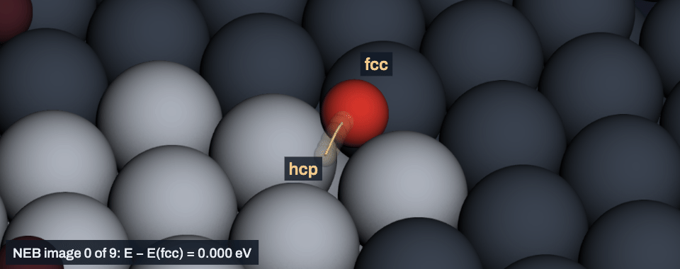
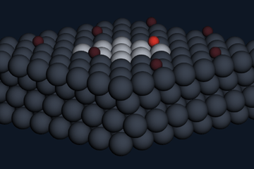
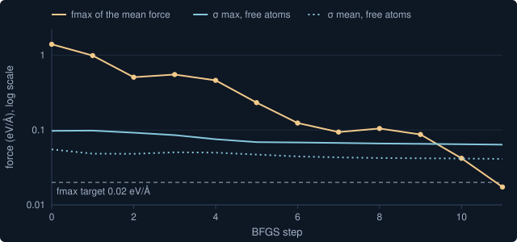
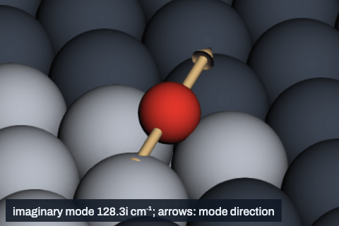
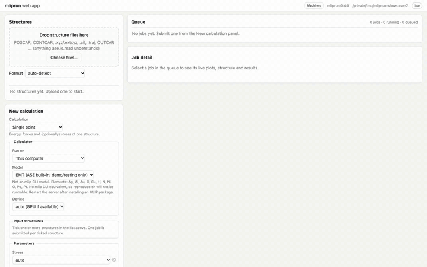

<!-- Generated by site/alt-5-cinematic/build_readme.py --root from site/alt-5-cinematic/data/*.json. Do not edit by hand. -->

# mliprun

*One CLI for machine-learning interatomic potentials: run it locally, or on your own GPU machine from the web app.*

[](https://github.com/manuelarcer/mliprun/actions/workflows/tests.yml)
[](https://github.com/manuelarcer/mliprun/actions/workflows/install-smoke.yml)



<sub>O hops fcc → hcp on Pt(111); NEB, barrier 0.544 eV. Images, not dynamics.</sub>

Works with UMA, MACE, SevenNet and CHGNet.

<table>
<tr>
<td width="380"></td>
<td>

**Relax an adsorbate.**<br>12 BFGS steps. **Converged:** fmax 0.0134 eV/Å.

`mlip optimize run --structure POSCAR --mlip uma-s-1p2 --uma-task oc20 --fmax 0.02`

<details><summary>command as run</summary>

`mlip optimize run --structure POSCAR --mlip uma-s-1p2 --uma-task oc20 --device cuda --fmax 0.02 --optimizer bfgs --max-steps 500`

</details>

</td>
</tr>
<tr>
<td width="380"></td>
<td>

**Know when your models disagree.** A committee of 3 MLIPs relaxes together.<br>Force σ at the end 0.0637 eV/Å, 3.68 × fmax. **Converged:** mean-force fmax 0.0173 eV/Å.

`mlip optimize run --structure POSCAR --committee committee.yaml --uncertainty-plot`

<details><summary>command as run</summary>

`mlip optimize run --structure POSCAR --committee committee.yaml --fmax 0.02 --optimizer bfgs --max-steps 500 --uncertainty-plot`

</details>

</td>
</tr>
<tr>
<td width="380"></td>
<td>

**Find the path, verify the TS.**<br>Barrier 0.544 eV; one imaginary mode, 128.3i cm⁻¹ (mode, not dynamics). **Converged:** band fmax 0.0177 eV/Å; TS verified.

`mlip neb run --initial o_fcc/opt_final.vasp --final o_hcp/opt_final.vasp --mlip uma-s-1p2 --uma-task oc20 --climb --verify-ts both`

<details><summary>command as run</summary>

`mlip neb run --initial o_fcc/opt_final.vasp --final o_hcp/opt_final.vasp --mlip uma-s-1p2 --uma-task oc20 --device cuda --num-images 7 --k 0.1 --climb --fmax 0.02 --optimize-endpoints --endpoint-fmax 0.02 --endpoint-optimizer bfgs --verify-ts both --plot`

</details>

</td>
</tr>
<tr>
<td width="380"></td>
<td>

**Send jobs to your own GPU machine from the web app.**<br>No preconfigured machines: add yours under Machines → Add machine. This job: 28.2 s wall time.

`mlip webapp`

</td>
</tr>
</table>

<sub>Showcase runs, uma-s-1p2/oc20, on cos-cluster (one GPU card). [Provenance](docs/showcase/data/pack/PROVENANCE.md).</sub>

**Also:** `md run` (NVE, NVT, NPT), `freq run`, `autoneb run`, `singlepoint run`, `benchmark`, `mlip doctor`.

## Install

```bash
git clone https://github.com/manuelarcer/mliprun.git && cd mliprun
python3 -m venv .venv && source .venv/bin/activate
pip install -e ".[neb]"
pip install mace-torch   # or UMA, SevenNet, CHGNet: one MLIP per environment
mlip doctor
```

Full guide, per-MLIP recipes and UMA access: [docs/INSTALL.md](docs/INSTALL.md).

## Docs

- [Command reference](docs/CLI.md): every command and option
- [Output files](docs/OUTPUTS.md) · [TS verification](docs/TS_VERIFICATION.md) · [MD reference](docs/MD_REFERENCE.md) · [Python API](docs/PYTHON_API.md)
- [Web app](webapp/README.md), including running on your own remote machine
- [Developing](docs/DEVELOPMENT.md) · [Contributing](CONTRIBUTING.md) · [Changelog](CHANGELOG.md)
- Using an AI coding assistant? Point it at [AGENTS.md](AGENTS.md).

## Acknowledgments

We gratefully acknowledge the contributions of:

- **Yifan Niu** (National University of Singapore) - Windows setup documentation and testing
- **Lee Yuan Zhang** (National University of Singapore) - Development and testing support

Special thanks to all contributors who have helped improve this platform.
