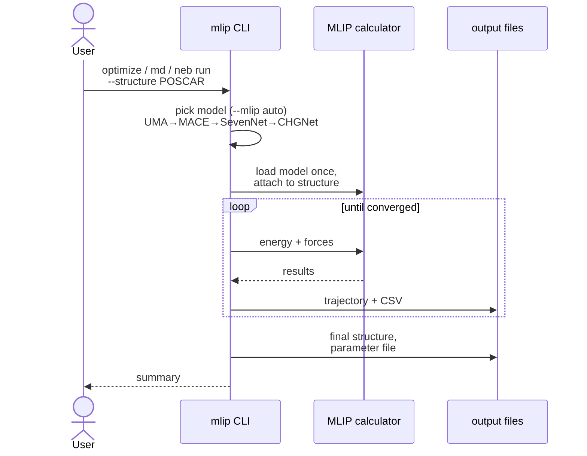

# Developing mliprun

Testing, internals and design notes. Contribution rules: [CONTRIBUTING.md](../CONTRIBUTING.md).

## How it works




---

## Testing

Install the test dependencies first (`[dev]` brings pytest and the coverage tools; `[neb]` the optional asetools):
```bash
pip install -e ".[dev,neb]"
```

Run all unit tests (no MLIP required):
```bash
pytest -m "not uma and not mace and not sevenn"
```

Run all tests including UMA integration:
```bash
pytest
```

Run specific test categories:
```bash
pytest tests/test_core_optimize.py     # Optimization tests (EMT)
pytest tests/test_core_md.py           # MD tests (EMT)
pytest tests/test_core_neb.py          # NEB tests (EMT)
pytest tests/test_neb_restart.py       # Restart logic tests
pytest tests/test_cli_commands.py      # CLI help/argument tests
pytest -m uma                          # UMA integration tests only
```


---

## Mirror on the A*STAR GHES

github.com is the main repository. A read-only copy lives at
`https://ghes.a-star.edu.sg/juar/mliprun` for users inside A*STAR.

- `scripts/mirror_to_ghes.sh` copies `main` and the tags to the GHES and then
  confirms that both servers show the same commit. Run it for an immediate
  update:
  ```bash
  scripts/mirror_to_ghes.sh
  ```
  It needs `git` and a `gh` login on the GHES
  (`gh auth login --hostname ghes.a-star.edu.sg`).
- The maintainer's Mac runs an installed copy of the script once a day through
  launchd (the macOS scheduler; job `com.juar.mliprun-ghes-mirror`). The copy
  can therefore be up to one day behind github.com. The job writes to
  `~/Library/Logs/mliprun-ghes-mirror.log` and shows a notification when it
  fails.
- A GitHub Actions workflow cannot do this: the GHES refuses connections from
  GitHub's hosted runners (HTTP 403 before any login; measured 2026-11-23).
- Never commit on the GHES copy. The push is not forced, so a commit made
  there makes the script fail until that commit is removed.
- Issues, pull requests and CI stay on github.com. On the GHES copy, issues
  and Actions are switched off.
- Feature branches are not mirrored.

## Developer notes

- CLI powered by [`typer`](https://typer.tiangolo.com/)
- Entry points defined in [pyproject.toml](../pyproject.toml) (`[project.scripts]`):
  ```toml
  [project.scripts]
  mlip = "mliprun.cli.main:app"
  md = "mliprun.cli.commands.md:app"
  neb = "mliprun.cli.commands.neb:app"
  autoneb = "mliprun.cli.commands.autoneb:app"
  autoneb-results = "mliprun.cli.commands.autoneb_results:app"
  benchmark = "mliprun.cli.commands.benchmark:app"
  optimize = "mliprun.cli.commands.optimize:app"
  singlepoint = "mliprun.cli.commands.singlepoint:app"
  freq = "mliprun.cli.commands.freq:app"
  ```
- Lazy imports for fast CLI startup (no heavy dependencies loaded until needed)
- Output locations: `optimize`/`singlepoint`/`freq`/`md` write next to the input structure (`singlepoint` and `freq` unless `--output-dir` overrides it); `neb`/`autoneb` write into the current working directory (see [OUTPUTS.md](OUTPUTS.md))
- Plots are opt-in via `--plot`; CSV data is always written
- Shared utilities in `core/utils.py` (fmax calculation, unit conversions)
- Parameter I/O in `core/params_io.py` (reduces duplication across commands)
- Optional integration with [asetools](https://github.com/manuelarcer/asetools) for NEB interpolation sanity checks (`pip install -e ".[neb]"`; the import in `core/neb.py` is guarded, so the platform runs without it)
