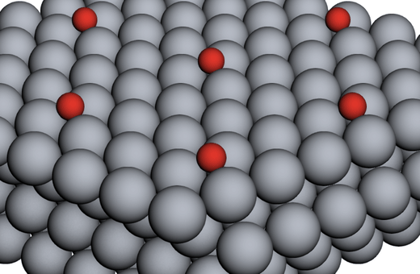
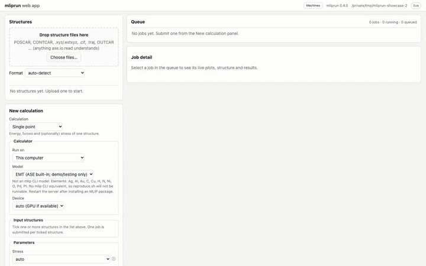

<!-- Generated by site/alt-1-terminal/build.py from docs/showcase/data/pack. Do not edit by hand. -->
# mliprun

[](https://github.com/manuelarcer/mliprun/actions/workflows/tests.yml)
[](https://github.com/manuelarcer/mliprun/actions/workflows/install-smoke.yml)

Machine-learning interatomic potentials (UMA, MACE, SevenNet, CHGNet), one command at a time.
Real runs of O on Pt(111), uma-s-1p2/oc20. **[Live page](https://manuelarcer.github.io/mliprun/)**

<picture>
  <source media="(prefers-color-scheme: dark)" srcset="media/terminal-dark.svg">
  
</picture>

<sub>Real log, excerpted and sped up. Runs ran on cos-cluster; elided paths are where they ran.</sub>

---

### `mlip optimize run` · converged

<picture>
  <source media="(prefers-color-scheme: dark)" srcset="media/relax3d-dark.gif">
  
</picture>

E −192.469 eV · fmax 0.0134 eV/Å · 12 BFGS steps · 3×3 periodic images

```bash
…/uma/bin/mlip optimize run \
    --structure …/01_relax/o_fcc/POSCAR --mlip uma-s-1p2 \
    --uma-task oc20 --device cuda --fmax 0.02 --optimizer bfgs \
    --max-steps 500
```

### `mlip optimize run --committee` · converged

<picture>
  <source media="(prefers-color-scheme: dark)" srcset="media/committee-dark.svg">
  
</picture>

σ max 0.0637 eV/Å, 3.7× the final fmax. Members: `uma-s-1p2@oc20`, `7net-omni@oc20`, `mace-mh-1@oc20_usemppbe`.

```bash
…/uma/bin/mlip optimize run \
    --structure POSCAR --committee committee.yaml --fmax 0.02 \
    --optimizer bfgs --max-steps 500 --uncertainty-plot
```

### `mlip neb run --verify-ts both` · converged, TS verified

<picture>
  <source media="(prefers-color-scheme: dark)" srcset="media/ts-mode-dark.gif">
  
</picture>

Barrier 0.544 eV · imaginary mode 128.3i cm⁻¹ (mode, not dynamics)

<details><summary>Flag</summary>

ts_verify reported endpoint fmax 0.0134 (IS) / 0.0174 (FS) eV/Å, above its internal displace-and-relax fmax of 0.01 eV/Å (the endpoints were relaxed to 0.02 eV/Å). The verdict is unaffected: both displaced relaxations matched their endpoint (result: connects).

</details>

### `mlip md run` · MD not run; next step pending a decision

```bash
…/uma/bin/mlip md run \
    --structure …/04_md/md/POSCAR --mlip uma-s-1p2 --uma-task oc20 \
    --device cuda --ensemble nvt --thermostat langevin \
    --friction 0.01 --temperature 300 --timestep 0.5 \
    --traj-interval 10 --steps 10000
```

Planned command from the run script; no output yet.

### `mlip webapp` · converged

<a href="media/webapp.mp4"></a>

The same relaxation from a browser (here sent to cos-cluster; waiting part ×3). No machines are preconfigured; you add your own.

<details><summary>Add your machine</summary>

1. Run `mlip webapp` on your laptop.
2. Machines → Add machine: Name, Host `<your ssh alias>` (an alias from `~/.ssh/config`),
   Default remote location `<your remote folder>`. Press Add machine.
3. On the saved machine: Add environment, Python path `<your uma env>/bin/python`, and a name.
4. Test connection on the saved machine, then submit a job to it.

</details>

---

**Also:** `mlip freq run` · `mlip autoneb run` · `mlip benchmark run` · SevenNet, CHGNet · `mlip doctor`

### Installation

One MLIP per environment; full recipe in [docs/INSTALL.md](https://github.com/manuelarcer/mliprun/blob/main/docs/INSTALL.md) and [AGENTS.md](https://github.com/manuelarcer/mliprun/blob/main/AGENTS.md).

```bash
git clone https://github.com/manuelarcer/mliprun.git && cd mliprun
python3 -m venv .venv && source .venv/bin/activate
pip install -e ".[neb]"
pip install mace-torch        # or fairchem-core (UMA, gated), sevenn, chgnet
mlip doctor
```

<sub>[Provenance](https://github.com/manuelarcer/mliprun/blob/main/docs/showcase/data/pack/PROVENANCE.md) · generated by `site/alt-1-terminal/build.py`.</sub>
