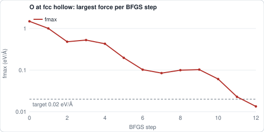
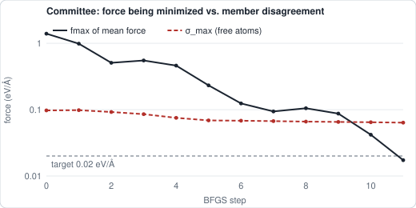
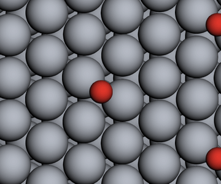

<!-- Generated by site/alt-1-terminal/build.py from docs/showcase/data/pack. Do not edit by hand. -->
# mliprun

[](https://github.com/manuelarcer/mliprun/actions/workflows/tests.yml)
[](https://github.com/manuelarcer/mliprun/actions/workflows/install-smoke.yml)

Run machine-learning interatomic potentials (UMA, MACE, SevenNet, CHGNet) from one CLI or
a small web app: relaxations, committees, NEB with transition-state checks, MD, and remote
runs on GPU machines you add yourself. Every block below is one command and the output it
really produced, for O on Pt(111) with uma-s-1p2/oc20. These showcase runs ran on cos-cluster;
the elided paths in the commands are where they ran, not paths to use.
**[Open the live page](https://manuelarcer.github.io/mliprun/)** (the replay, the energy profile and the TS mode in 3D).

<picture>
  <source media="(prefers-color-scheme: dark)" srcset="media/terminal-dark.svg">
  
</picture>

<sub>Replay of the real run. The log is excerpted (every 9th of mliprun's 46 Step
lines) and paced faster than the run; nothing is added. Install: see [Installation](#installation).</sub>

---

### `mlip optimize run` → one adsorbate, relaxed (converged)

```bash
…/uma/bin/mlip optimize run \
    --structure …/01_relax/o_fcc/POSCAR --mlip uma-s-1p2 \
    --uma-task oc20 --device cuda --fmax 0.02 --optimizer bfgs \
    --max-steps 500
```

<table><tr><td>

<picture>
  <source media="(prefers-color-scheme: dark)" srcset="media/relax3d-dark.gif">
  
</picture>

</td><td>

| result | value |
|---|---|
| total energy, O at fcc | -192.469 eV |
| final fmax (target 0.02 eV/Å) | 0.0134 eV/Å |
| BFGS steps | 12 |
| O height above top Pt layer | 1.13 Å |
| shortest O–Pt | 2.06 Å |
| E(hcp) − E(fcc) | 0.368 eV |

</td></tr></table>

<picture>
  <source media="(prefers-color-scheme: dark)" srcset="media/relax-dark.svg">
  
</picture>

### `mlip optimize run --committee` → an error bar on the relaxation (converged)

```bash
…/uma/bin/mlip optimize run \
    --structure POSCAR --committee committee.yaml --fmax 0.02 \
    --optimizer bfgs --max-steps 500 --uncertainty-plot
```

Members: `uma-s-1p2@oc20`, `7net-omni@oc20`, `mace-mh-1@oc20_usemppbe`. At the final step the largest
per-atom force disagreement on the free atoms is
**0.0637 eV/Å**, 3.7× the
0.0173 eV/Å left in the mean force that the
optimizer minimized. Energy spread across members (standard
deviation, step-0 aligned): 0.0061 eV.

<picture>
  <source media="(prefers-color-scheme: dark)" srcset="media/committee-dark.svg">
  
</picture>

### `mlip neb run --verify-ts both` → a barrier, and a checked TS (converged)

The command in the replay above. Results:

<table><tr><td>

<picture>
  <source media="(prefers-color-scheme: dark)" srcset="media/ts-mode-dark.gif">
  
</picture>

</td><td>

| result | value |
|---|---|
| forward barrier, fcc → hcp | 0.544 eV |
| reverse barrier, hcp → fcc | 0.176 eV |
| imaginary mode at the TS | 128.3i cm⁻¹ |
| overlap with NEB tangent (threshold 0.7) | 0.962 |
| final band fmax | 0.0177 eV/Å |
| largest drift from seed band (allowance 1.12 Å) | 0.11 Å |

</td></tr></table>

<sub>The mode is drawn at 0.3 Å peak displacement: an
illustration of the mode, not dynamics. Flag: ts_verify reported endpoint fmax 0.0134 (IS) / 0.0174 (FS) eV/Å, above its internal displace-and-relax fmax of 0.01 eV/Å (the endpoints were relaxed to 0.02 eV/Å). The verdict is unaffected: both displaced relaxations matched their endpoint (result: connects).</sub>

### `mlip md run` → MD not run; next step pending a decision

```bash
…/uma/bin/mlip md run \
    --structure …/04_md/md/POSCAR --mlip uma-s-1p2 --uma-task oc20 \
    --device cuda --ensemble nvt --thermostat langevin \
    --friction 0.01 --temperature 300 --timestep 0.5 \
    --traj-interval 10 --steps 10000
```

**Status: MD not run; next step pending a decision.** This is the command the run script would issue
(docs/showcase/scripts/run_04_md.sh); it has not run. There is no output to show, and none is
simulated here.

### `mlip webapp` → the same relaxation, sent from a browser to a remote GPU machine (converged)

mliprun ships with no machines configured; you add your own:

1. Run `mlip webapp` on your laptop.
2. Machines → Add machine: Name, Host `<your ssh alias>` (an alias from `~/.ssh/config`),
   Default remote location `<your remote folder>`. Press Add machine.
3. On the saved machine: Add environment, Python path `<your uma env>/bin/python`, and a name.
4. Test connection on the saved machine, then submit a job to it.

In the recording below, the machine was cos-cluster, where the showcase runs ran.

<a href="media/webapp.mp4"></a>

<sub>Screen recording of a real job (26.5 s; the waiting
part is sped up ×3 and labelled in the video). Wall time on cos-cluster:
28.2 s including model load. The result differs from the CLI run
by 2.2e-06 eV (GPU floating-point noise).
Click for the MP4.</sub>

The same job is one command:

```bash
mlip optimize run \
    --structure POSCAR --mlip uma-s-1p2 --uma-task oc20 \
    --device cuda --optimizer bfgs --fmax 0.02 --max-steps 500 \
    --no-plot
```

---

### Also in the box

`mlip freq run` frequencies and zero-point energy · `mlip autoneb run` dynamic image
insertion · `mlip benchmark run` model timings · SevenNet and CHGNet alongside UMA and MACE ·
`mlip doctor` environment self-check.

### Installation

One MLIP per environment. The full recipe, the asetools warning and the gated-UMA steps
are in [docs/INSTALL.md](https://github.com/manuelarcer/mliprun/blob/main/docs/INSTALL.md) and [AGENTS.md](https://github.com/manuelarcer/mliprun/blob/main/AGENTS.md).
Short form:

```bash
git clone https://github.com/manuelarcer/mliprun.git && cd mliprun
python3 -m venv .venv && source .venv/bin/activate
pip install -e ".[neb]"
pip install mace-torch        # or fairchem-core (UMA, gated), sevenn, chgnet
mlip doctor
```

<sub>Data: [provenance of every number and frame](https://github.com/manuelarcer/mliprun/blob/main/docs/showcase/data/pack/PROVENANCE.md). Generated
2026-11-18 by `site/alt-1-terminal/build.py`.</sub>
