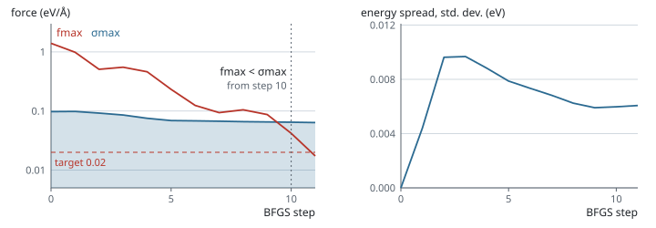
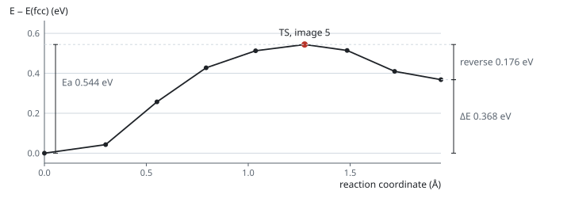
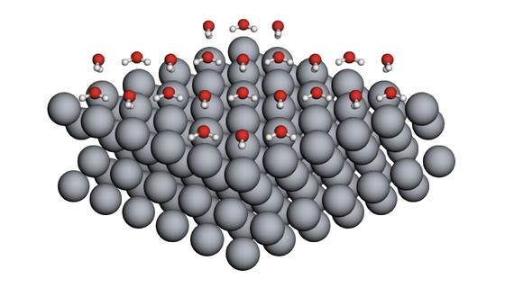
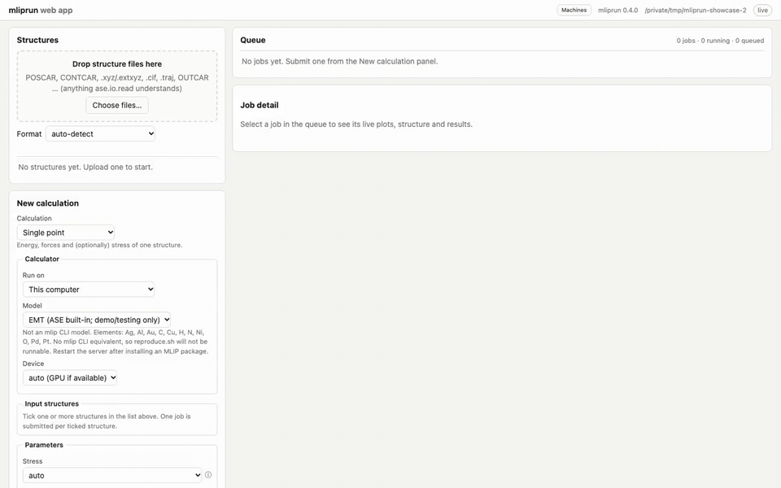

# mliprun

[](https://github.com/manuelarcer/mliprun/actions/workflows/tests.yml)
[](https://github.com/manuelarcer/mliprun/actions/workflows/install-smoke.yml)

Machine-learning interatomic potentials from one command line: relaxations, model committees, NEB with transition-state checks, MD, and remote runs on GPU machines you add yourself. UMA, MACE, SevenNet and CHGNet, each in its own environment.

**One oxygen atom, followed from start to finish.** O on Pt(111), uma-s-1p2/oc20, force target 0.02 eV/Å. Each chapter below is one real run from the showcase data pack. The [interactive version](https://manuelarcer.github.io/mliprun/) replays the same runs in 3D as you scroll.

To run any of this yourself, start with the [installation steps](docs/INSTALL.md) (one MLIP per environment).

## 1. Relax the adsorbate (converged)

Start every surface study here: `mlip optimize run` moves the free atoms until the largest force on any of them drops below `--fmax`.

```bash
mlip optimize run \
  --structure POSCAR \
  --mlip uma-s-1p2 \
  --uma-task oc20 \
  --device cuda \
  --fmax 0.02 \
  --optimizer bfgs \
  --max-steps 500
```

<picture>
  <source media="(prefers-color-scheme: dark)" srcset="media/chart-relax-dark.svg">
  
</picture>

Forces fall from 1.49 eV/Å to 0.0134 eV/Å in 12 steps. The energy drops by 0.254 eV, 90% of it in the first 4 steps. The geometry barely moves: the O atom sinks from 1.20 Å to 1.13 Å above the top Pt layer, too small to see in a picture of the slab, so this chapter shows the chart only. The same command at the hcp hollow gives E(hcp) − E(fcc) = 0.368 eV.

## 2. Ask a committee how sure it is (converged)

Add `--committee` and the relaxation runs with 3 models at once (uma-s-1p2@oc20, 7net-omni@oc20, mace-mh-1@oc20_usemppbe), follows their mean force, and records how far they disagree.

```bash
mlip optimize run \
  --structure POSCAR \
  --committee committee.yaml \
  --fmax 0.02 \
  --optimizer bfgs \
  --max-steps 500 \
  --uncertainty-plot
```

<picture>
  <source media="(prefers-color-scheme: dark)" srcset="media/committee-dark.png">
  
</picture>

<picture>
  <source media="(prefers-color-scheme: dark)" srcset="media/chart-committee-dark.svg">
  
</picture>

**The blue line, σmax, is the largest force disagreement between the models over the free atoms. Once the force being minimised (fmax, red) drops below it, into the shaded zone, the remaining force is smaller than what these models can tell apart.** Here fmax drops below σmax at step 10. At the last step the disagreement is 0.064 eV/Å, 3.7 times the final force of 0.0173 eV/Å. The energy spread ends at 0.0061 eV (standard deviation after each member's step-0 energy is subtracted).

The atom colours are the per-atom disagreement at the committee's final step, drawn on the chapter 1 geometry (the committee run saves numbers, not frames).

## 3. Find the path between the hollows (converged)

`mlip neb run` builds a band from the fcc to the hcp minimum, relaxes it, and lets the highest image climb to the saddle point.

```bash
mlip neb run \
  --initial o_fcc/opt_final.vasp \
  --final o_hcp/opt_final.vasp \
  --mlip uma-s-1p2 \
  --uma-task oc20 \
  --device cuda \
  --num-images 7 \
  --k 0.1 \
  --climb \
  --fmax 0.02 \
  --optimize-endpoints \
  --endpoint-fmax 0.02 \
  --endpoint-optimizer bfgs \
  --verify-ts both \
  --plot
```

<picture>
  <source media="(prefers-color-scheme: dark)" srcset="media/neb-dark.gif">
  
</picture>

<picture>
  <source media="(prefers-color-scheme: dark)" srcset="media/chart-neb-dark.svg">
  
</picture>

7 images between the relaxed endpoints, converged to 0.0177 eV/Å in 45 steps. Forward barrier 0.544 eV, reverse 0.176 eV, reaction energy 0.368 eV. No atom drifted more than 0.108 Å from the seeded band (allowance 1.12 Å).

## 4. Check that the top is a real saddle (TS verified)

`--verify-ts both` asks three questions of the climbing image: is there exactly one imaginary mode, does it point along the path, and does relaxing off it land in the two minima.

<picture>
  <source media="(prefers-color-scheme: dark)" srcset="media/ts-dark.gif">
  
</picture>

One imaginary mode at 128.3i cm⁻¹. Overlap with the NEB tangent 0.962 (threshold 0.7); displaced along the mode and relaxed, the structure connects to both endpoints. The animation is the mode scaled so the most-displaced atom moves 0.3 Å: an illustration, not dynamics.

> Flag raised by the check: ts_verify reported endpoint fmax 0.0134 (IS) / 0.0174 (FS) eV/Å, above its internal displace-and-relax fmax of 0.01 eV/Å (the endpoints were relaxed to 0.02 eV/Å). The verdict is unaffected: both displaced relaxations matched their endpoint (result: connects).

## 5. Water at finite temperature (pending)

**MD not run; next step pending a decision.**

The story moves to a new system, a bilayer of 6 water molecules on Pt(111). The picture shows the 6-H2O bilayer on Pt(111) as built (input to the bilayer relaxation): a static structure, not a simulation.

<picture>
  <source media="(prefers-color-scheme: dark)" srcset="media/water-dark.png">
  
</picture>

## 6. Run it on your own GPU machine from the browser (converged)

`mlip webapp` sends a job to a remote machine that you add yourself and brings the result back: the GPU does the work, your laptop only submits. mliprun ships with no preconfigured machines.

1. In the web app, open **Machines** and choose **Add machine**: your SSH alias (`<your ssh alias>`) and your remote folder (`<your remote folder>`).
2. Point it at your own MLIP environment (`<your uma env>`).
3. Press **Test connection**, then submit. The web app runs the same command as the CLI:

```bash
mlip optimize run \
  --structure POSCAR \
  --mlip uma-s-1p2 \
  --uma-task oc20 \
  --device cuda \
  --optimizer bfgs \
  --fmax 0.02 \
  --max-steps 500 \
  --no-plot
```



In the recording, the chapter 1 relaxation runs on cos-cluster, the machine where all showcase runs in this README ran (one GPU card); your machine will be the one you add. Timing: 28.2 s in total, 3.1 s of it relaxation and the rest loading the model. Same 12 steps as the command line, energy difference 2.2 × 10⁻⁶ eV (GPU floating-point noise). The waiting part of the recording is sped up 3× and labelled so. [Full-quality video](data/webapp.mp4).

## Also in mliprun

- `mlip freq run`: finite-difference frequencies, imaginary-mode count and zero-point energy, with per-member spread from a committee.
- `mlip autoneb run`: NEB with images inserted where the path needs them.
- `mlip benchmark run`: times one energy call for each installed MLIP on the same structure.
- `--mlip`: UMA, MACE, SevenNet and CHGNet, each in its own environment.
- `mlip doctor`: checks that an environment can import and run its model.

Where each number comes from: [data pack provenance](https://github.com/manuelarcer/mliprun/blob/main/docs/showcase/data/pack/PROVENANCE.md). Installation: [docs/INSTALL.md](docs/INSTALL.md).
