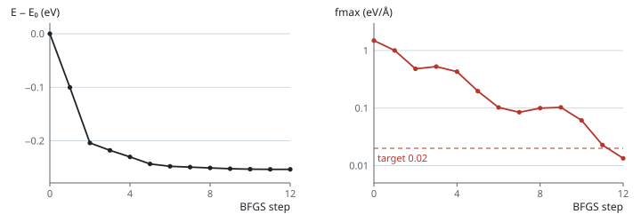
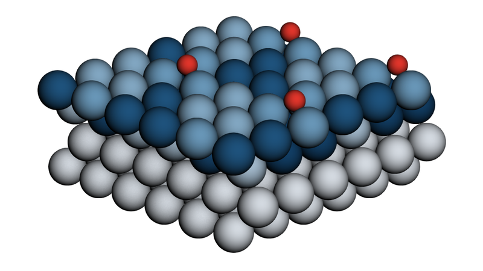
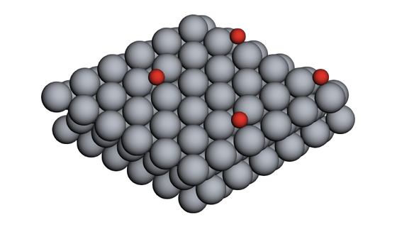
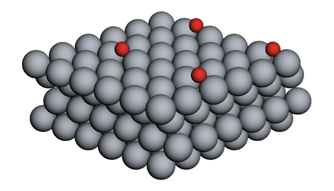

# mliprun

[](https://github.com/manuelarcer/mliprun/actions/workflows/tests.yml)
[](https://github.com/manuelarcer/mliprun/actions/workflows/install-smoke.yml)

## One system, from first relaxation to a run on your own GPU machine

O on Pt(111), uma-s-1p2/oc20, fmax 0.02 eV/Å. [Interactive version](https://manuelarcer.github.io/mliprun/). [Install](docs/INSTALL.md) (one MLIP per environment).

### 1. Relax (converged)

<picture>
  <source media="(prefers-color-scheme: dark)" srcset="media/chart-relax-dark.svg">
  
</picture>

12 steps, fmax 0.0134 eV/Å, ΔE −0.254 eV, O height 1.20 → 1.13 Å.

```bash
mlip optimize run \
  --structure POSCAR \
  --mlip uma-s-1p2 \
  --uma-task oc20 \
  --device cuda \
  --fmax 0.02 \
  --optimizer bfgs \
  --max-steps 500
```

### 2. Committee (converged)

<picture>
  <source media="(prefers-color-scheme: dark)" srcset="media/committee-dark.png">
  
</picture>

<picture>
  <source media="(prefers-color-scheme: dark)" srcset="media/chart-committee-dark.svg">
  
</picture>

uma-s-1p2@oc20, 7net-omni@oc20, mace-mh-1@oc20_usemppbe. fmax < σmax from step 10; σmax 0.064 eV/Å.

```bash
mlip optimize run \
  --structure POSCAR \
  --committee committee.yaml \
  --fmax 0.02 \
  --optimizer bfgs \
  --max-steps 500 \
  --uncertainty-plot
```

### 3. NEB, fcc → hcp (converged)

<picture>
  <source media="(prefers-color-scheme: dark)" srcset="media/neb-dark.gif">
  
</picture>

<picture>
  <source media="(prefers-color-scheme: dark)" srcset="media/chart-neb-dark.svg">
  
</picture>

Barrier 0.544 eV, reverse 0.176 eV, ΔE 0.368 eV.

```bash
mlip neb run \
  --initial o_fcc/opt_final.vasp \
  --final o_hcp/opt_final.vasp \
  --mlip uma-s-1p2 \
  --uma-task oc20 \
  --device cuda \
  --num-images 7 \
  --k 0.1 \
  --climb \
  --fmax 0.02 \
  --optimize-endpoints \
  --endpoint-fmax 0.02 \
  --endpoint-optimizer bfgs \
  --verify-ts both \
  --plot
```

### 4. TS check (TS verified)

<picture>
  <source media="(prefers-color-scheme: dark)" srcset="media/ts-dark.gif">
  
</picture>

`--verify-ts both`: 128.3i cm⁻¹, overlap 0.962 (≥ 0.7). Mode, not dynamics.

<details><summary>Flag from the check</summary>

ts_verify reported endpoint fmax 0.0134 (IS) / 0.0174 (FS) eV/Å, above its internal displace-and-relax fmax of 0.01 eV/Å (the endpoints were relaxed to 0.02 eV/Å). The verdict is unaffected: both displaced relaxations matched their endpoint (result: connects).

</details>

### 5. Water on Pt(111) (pending)

<picture>
  <source media="(prefers-color-scheme: dark)" srcset="media/water-dark.png">
  
</picture>

**MD not run; next step pending a decision.** 6 H₂O as built; static, not a simulation.

### 6. Remote run from the browser (converged)


`mlip webapp` on a GPU machine you add; none are preconfigured. **Machines → Add machine** (Host `<your ssh alias>`, Default remote location `<your remote folder>`), save; **Add environment** (Python path `<your uma env>/bin/python`); **Test connection**; submit. Showcase run on cos-cluster: 28.2 s, web app − CLI 2.2 × 10⁻⁶ eV. Waiting part ×3. [Video](data/webapp.mp4).

### Also in mliprun

- `mlip freq run`: frequencies, ZPE
- `mlip autoneb run`: NEB with inserted images
- `mlip benchmark run`: model timing
- `--mlip`: UMA, MACE, SevenNet, CHGNet
- `mlip doctor`: environment check

[Data provenance](https://github.com/manuelarcer/mliprun/blob/main/docs/showcase/data/pack/PROVENANCE.md). Installation: [docs/INSTALL.md](docs/INSTALL.md).
