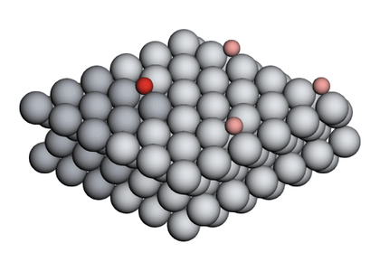
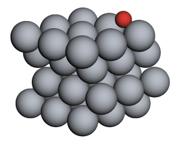
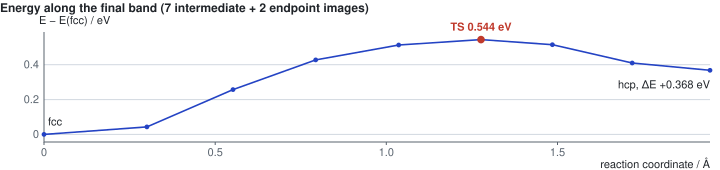
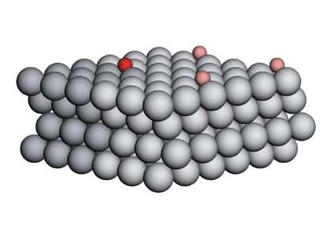
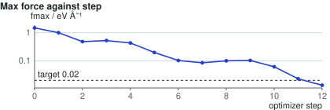
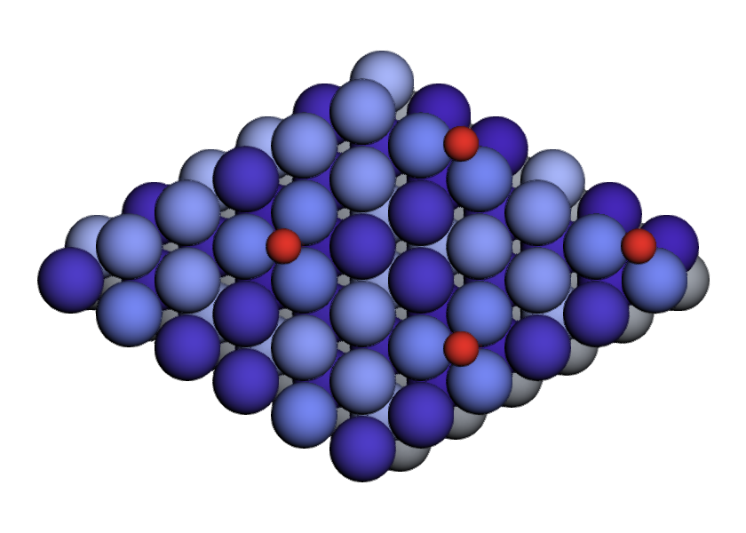
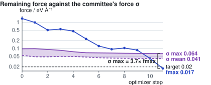
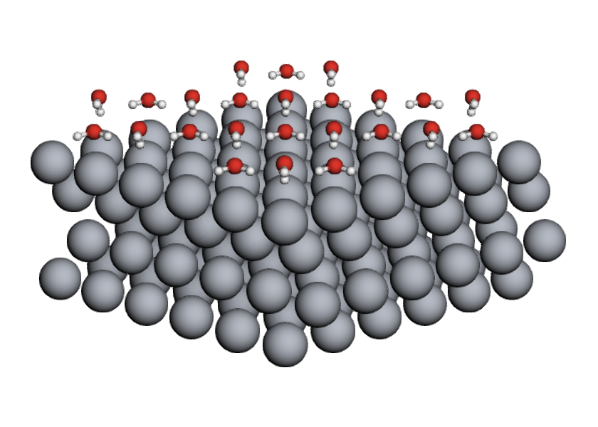
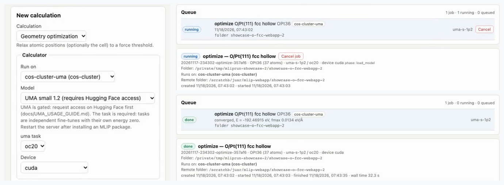
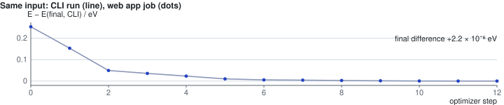

# mliprun

[](https://github.com/manuelarcer/mliprun/actions/workflows/tests.yml)
[](https://github.com/manuelarcer/mliprun/actions/workflows/install-smoke.yml)

Machine-learning interatomic potentials from one command: relaxations, committees, NEB with a transition-state check, MD, and jobs sent to a remote GPU machine you add yourself. UMA, MACE, SevenNet and CHGNet.

**[Open the live gallery](https://manuelarcer.github.io/mliprun/)** for rotatable 3D panels, **[install](../../docs/INSTALL.md)**, or **[run it on your own GPU machine](#run-it-on-your-own-gpu-machine)**.

Plate 1. Four real runs and one pending (MD) on Pt(111), single-model runs uma-s-1p2/oc20, run on cos-cluster (one GPU card). Numbers are generated from the run records.

<table>
<tr><td colspan="2">
<b>a</b>&nbsp; <b>O hops fcc → hcp, barrier 0.544 eV</b> (converged, TS verified)<br>
<picture><source media="(prefers-color-scheme: dark)" srcset="media/neb-dark.gif"></picture><picture><source media="(prefers-color-scheme: dark)" srcset="media/tsmode-dark.gif"></picture>
<br><sub>TS mode: 128.3i cm⁻¹, overlap 0.962 (≥ 0.7); mode, not dynamics.</sub>
<br><picture><source media="(prefers-color-scheme: dark)" srcset="media/strip-neb-dark.svg"></picture>
<br><code>mlip neb run --num-images 7 --climb --verify-ts both …</code>
</td></tr>
<tr><td width="50%" valign="top">
<b>b</b>&nbsp; <b>Relaxation, 12 BFGS steps</b> (converged)<br>
<picture><source media="(prefers-color-scheme: dark)" srcset="media/relax-dark.gif"></picture>
<br><picture><source media="(prefers-color-scheme: dark)" srcset="media/strip-relax-dark.svg"></picture>
<br><code>mlip optimize run --mlip uma-s-1p2 --uma-task oc20 --fmax 0.02 …</code>
</td><td width="50%" valign="top">
<b>c</b>&nbsp; <b>Committee: σ max 3.7× fmax</b> (converged)<br>
<picture><source media="(prefers-color-scheme: dark)" srcset="media/committee-dark.png"></picture>
<br><sub>Start geometry, force σ per atom at the last step: pale 0 → violet 0.064 eV/Å; O red.</sub>
<br><picture><source media="(prefers-color-scheme: dark)" srcset="media/strip-committee-dark.svg"></picture>
<br><code>mlip optimize run --committee committee.yaml --fmax 0.02 …</code>
</td></tr>
<tr><td valign="top">
<b>d</b>&nbsp; <b>MD: not run; next step pending a decision</b><br>
<picture><source media="(prefers-color-scheme: dark)" srcset="media/md-dark.png"></picture>
<br><sub>6-H2O bilayer on Pt(111) as built (input to the bilayer relaxation). Static, not a simulation.</sub>
<br><code>mlip md run …</code>
</td><td valign="top">
<b>Also in mliprun</b>
<ul><li><code>mlip freq run</code> frequencies, imaginary modes, ZPE</li><li><code>mlip autoneb run</code> NEB with image insertion</li><li><code>mlip ts verify</code> TS check on its own</li><li><code>mlip benchmark run</code> model benchmarks</li><li><code>mlip doctor</code> environment check</li><li>UMA, MACE, SevenNet, CHGNet; one MLIP per environment</li></ul>
</td></tr>
<tr><td colspan="2">
<b>e</b>&nbsp; <b>Web app → cos-cluster: 28.2 s job</b> (converged)<br>
<picture><source media="(prefers-color-scheme: dark)" srcset="media/webapp-stills-dark.png"></picture>
<br><sub>Submit, running, done. <a href="data/webapp.mp4">Recording</a> (26.5 s).</sub>
<br><picture><source media="(prefers-color-scheme: dark)" srcset="media/strip-webapp-dark.svg"></picture>
<br><code>mlip webapp</code>
</td></tr>
</table>

<sub>[Data and provenance](https://github.com/manuelarcer/mliprun/blob/main/docs/showcase/data/pack/PROVENANCE.md).</sub>

## Run it on your own GPU machine

No machines are preconfigured: add your own. CLI, on your GPU machine:

```bash
mlip optimize run --structure POSCAR --mlip uma-s-1p2 --uma-task oc20 --device cuda --fmax 0.02 --optimizer bfgs --max-steps 500
```

Web app (`mlip webapp`): *Machines* → *Add machine* (*Host* `<your ssh alias>`, *Default remote location* `<your remote folder>`) → *Add environment* (*Python path* `<your uma env>/bin/python`) → *Test connection*. [Guide](https://github.com/manuelarcer/mliprun/blob/main/webapp/README.md#running-on-another-machine-ssh).

## Installation

See **[docs/INSTALL.md](../../docs/INSTALL.md)**.
