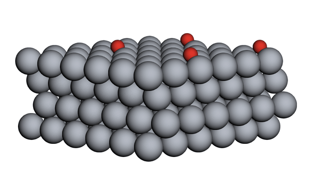
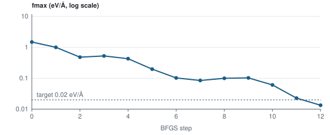
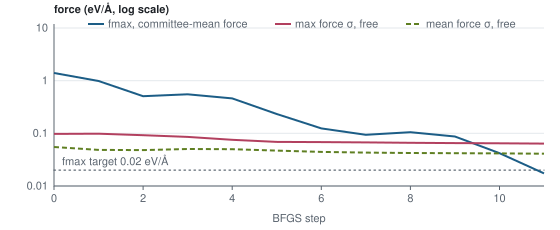
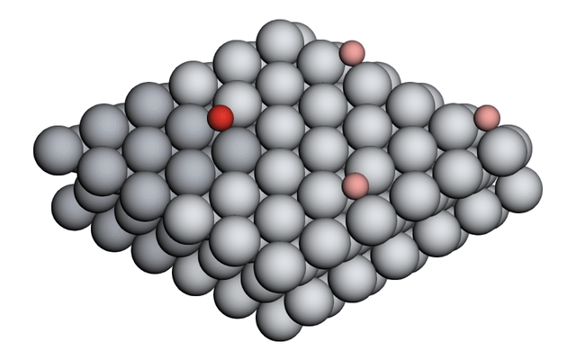
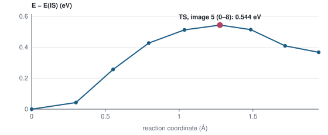
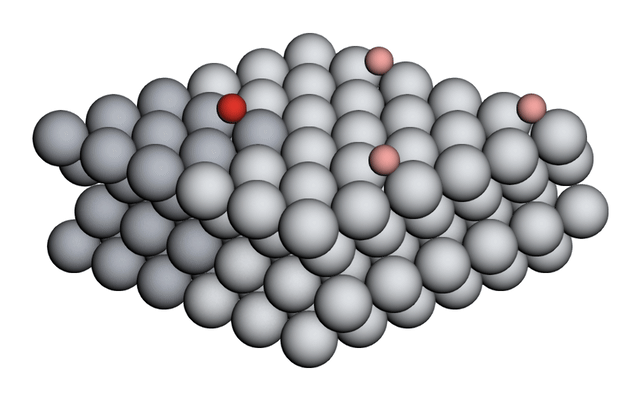
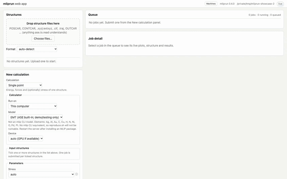

<!-- Generated by site/alt-4-handbook/build_readme.py from data/*.json. Do not edit by hand. -->
# mliprun

[](https://github.com/manuelarcer/mliprun/actions/workflows/tests.yml)
[](https://github.com/manuelarcer/mliprun/actions/workflows/install-smoke.yml)

**Handbook: set up mliprun on your own machines.** No preconfigured machines: you add your own.
Every result below is a real run (mliprun `2b3044b`, uma-s-1p2/oc20; showcase runs on
cos-cluster, one GPU card). Live 3D version: [landing page](index.html).

Install: see [Installation](../../docs/INSTALL.md) and [AGENTS.md](../../AGENTS.md).

## Five results at a glance

| Job | Command | Result | Status |
|---|---|---|---|
| [Relax an adsorbate](#relax-an-adsorbate) | `mlip optimize run` | final fmax 0.0134 eV/Å (target 0.02 eV/Å) | converged |
| [Relax with a committee](#relax-with-a-committee) | `mlip optimize run --committee` | max force σ on free atoms 0.0637 eV/Å at the final step | converged |
| [Find and check a TS](#find-and-check-a-transition-state) | `mlip neb run --verify-ts` | barrier 0.544 eV, one imaginary mode 128.3i cm⁻¹ | converged, TS verified |
| [Run MD](#run-md-pending) | `mlip md run` | MD not run; next step pending a decision | pending |
| [Send a job from the web app](#send-a-job-from-the-web-app) | `mlip webapp` | 28.2 s wall time of the showcase job | converged |

## Setup

Do this once on each machine you use. The recipes assume it is done.

### Which machine

Your laptop, or a remote GPU machine you add yourself (password-free SSH, Linux, an environment
with mliprun). No scheduler? Check the GPU table and use one free card.

```bash
# on your GPU machine: which cards are busy?
nvidia-smi
export CUDA_VISIBLE_DEVICES=<free card>
```

### Which environment

One MLIP per Python environment, with mliprun installed in each.

```bash
git clone https://github.com/manuelarcer/mliprun.git
cd mliprun
python3 -m venv <your uma env>     # a folder you choose
source <your uma env>/bin/activate
pip install -e .
pip install fairchem-core      # UMA; one MLIP package in this env only
```

<details><summary>Environments the showcase runs used (provenance only, not for you to use)</summary>

| MLIP / head | Package | Used by | Where these runs happened |
|---|---|---|---|
| `uma-s-1p2` / `oc20` | fairchem-core | relax, NEB, bilayer relax, web app job, committee member | `/scratchb/juar/EWaste2GreenCat/explicit_solvation/.venv/uma` |
| `7net-omni` / `oc20` | sevenn | committee member | `/scratchb/juar/EWaste2GreenCat/explicit_solvation/.venv/sevenn` |
| `mace-mh-1` / `oc20_usemppbe` | mace-torch | committee member | `/scratchb/juar/EWaste2GreenCat/explicit_solvation/.venv/mace` |

</details>

UMA weights are gated on Hugging Face ([UMA guide](../../docs/UMA_USAGE_GUIDE.md)). Never
`pip install asetools` (the PyPI package is unrelated); use `pip install -e ".[neb]"`.
Per-MLIP recipes: [docs/install](../../docs/install/README.md).

### Check the environment

```bash
source <your uma env>/bin/activate
mlip doctor        # versions, installed MLIPs, CUDA; non-zero exit if no MLIP
```

Always name the model and its head (`--mlip uma-s-1p2 --uma-task oc20`); each head has its own
energy zero.

### Add your machine in the web app

```bash
pip install -e ".[webapp]"     # on the laptop only
mlip webapp                    # opens http://127.0.0.1:8765/
```

1. **Machines → Add machine.** Name: any. Host: `<your ssh alias>` (from `~/.ssh/config`).
   Default remote location: `<your remote folder>`. Press **Add machine**.
2. **Add environment**, on the saved machine's card. Python path: `<your uma env>/bin/python`, plus a Name.
3. **Test connection**, on the saved machine (host and GPU table; it does not check the load).
4. **Run on.** In the job form, choose your environment; submit.

## Recipes

The command that ran; fill in every `<…>`.

### Relax an adsorbate

<picture>
  <source media="(prefers-color-scheme: dark)" srcset="media/relax-dark.gif">
  
</picture>

O relaxes in the fcc hollow of Pt(111). Converged.

```bash
source <your uma env>/bin/activate
mlip optimize run \
  --structure <your POSCAR> --mlip uma-s-1p2 \
  --uma-task oc20 --device cuda --fmax 0.02 \
  --optimizer bfgs --max-steps 500
```

| Quantity | Value |
|---|---|
| final fmax, O at fcc hollow | 0.0134 eV/Å |
| BFGS steps, O at fcc hollow | 12 steps |
| total energy, O at fcc hollow | -192.4692 eV |
| O height above top Pt layer, fcc | 1.127 Å |
| Pt lattice constant a | 3.990 Å |

<details><summary>Convergence chart, run details, exactly as run</summary>

<picture>
  <source media="(prefers-color-scheme: dark)" srcset="media/relax-fmax-dark.svg">
  
</picture>

Slab: Pt(111) 3x3, 4 layers, bottom 2 fixed, cut from the relaxed a.

Exactly as run:

```bash
/scratchb/juar/EWaste2GreenCat/explicit_solvation/.venv/uma/bin/mlip optimize run --structure /scratchb/juar/mliprun-showcase/01_relax/o_fcc/POSCAR --mlip uma-s-1p2 --uma-task oc20 --device cuda --fmax 0.02 --optimizer bfgs --max-steps 500
```

</details>

### Relax with a committee

<picture>
  <source media="(prefers-color-scheme: dark)" srcset="media/committee-force-dark.svg">
  
</picture>

Three MLIPs relax together; their disagreement is the uncertainty. Converged.

```bash
# members run in the envs named in committee.yaml
source <your uma env>/bin/activate
mlip optimize run \
  --structure <your POSCAR> \
  --committee committee.yaml --fmax 0.02 \
  --optimizer bfgs --max-steps 500 --uncertainty-plot
```

```yaml
members:
  - env:  <your uma env>
    mlip: uma-s-1p2
    uma_task: oc20
    gpu: 0

  - env:  <your sevenn env>
    mlip: 7net-omni
    sevennet_task: oc20
    gpu: 0

  - env:  <your mace env>
    mlip: mace-mh-1
    mace_head: oc20_usemppbe
    gpu: 0
```

| Quantity | Value |
|---|---|
| max force σ on free atoms, final step | 0.0637 eV/Å |
| max force σ on free atoms / fmax, final step | 3.68 |
| final fmax of the committee-mean force | 0.0173 eV/Å |
| energy spread across members, final step | 0.00607 eV |
| BFGS steps | 11 steps |

<details><summary>Run details, exactly as run</summary>

Same start structure; all members at the OC20 (RPBE) level, each in its own environment.
`gpu: N` is the physical card for that member.

Exactly as run:

```bash
/scratchb/juar/EWaste2GreenCat/explicit_solvation/.venv/uma/bin/mlip optimize run --structure POSCAR --committee committee.yaml --fmax 0.02 --optimizer bfgs --max-steps 500 --uncertainty-plot
# folder: /scratchb/juar/mliprun-showcase/02_committee
```

</details>

### Find and check a transition state

<picture>
  <source media="(prefers-color-scheme: dark)" srcset="media/neb-band-dark.gif">
  
</picture>

O hops fcc → hcp on Pt(111); barrier 0.544 eV. Converged, TS verified.

```bash
source <your uma env>/bin/activate
# NEB writes into the current folder
cd <neb run folder>
mlip neb run \
  --initial <IS POSCAR> --final <FS POSCAR> \
  --mlip uma-s-1p2 --uma-task oc20 --device cuda \
  --num-images 7 --k 0.1 --climb --fmax 0.02 \
  --optimize-endpoints --endpoint-fmax 0.02 \
  --endpoint-optimizer bfgs --verify-ts both --plot
```

| Quantity | Value |
|---|---|
| forward barrier, fcc → hcp | 0.544 eV |
| reverse barrier, hcp → fcc | 0.176 eV |
| reaction energy, E(hcp) − E(fcc) | 0.368 eV |
| TS imaginary frequency | 128.3i cm⁻¹ |
| overlap of imaginary mode with NEB tangent | 0.962 |
| final band fmax | 0.0177 eV/Å |

<details><summary>Energy profile, TS mode (mode, not dynamics), 1 flag, exactly as run</summary>

<picture>
  <source media="(prefers-color-scheme: dark)" srcset="media/neb-profile-dark.svg">
  
</picture>

<picture>
  <source media="(prefers-color-scheme: dark)" srcset="media/ts-mode-dark.gif">
  
</picture>

Climbing-image NEB with 7 intermediate + 2 endpoint images (9 in all), then the
TS frequency check and a displace-and-relax check both ways. NEB defaults to CPU: pass `--device cuda`.

**Flag.** ts_verify reported endpoint fmax 0.0134 (IS) / 0.0174 (FS) eV/Å, above its internal displace-and-relax fmax of 0.01 eV/Å (the endpoints were relaxed to 0.02 eV/Å). The verdict is unaffected: both displaced relaxations matched their endpoint (result: connects).

Exactly as run:

```bash
/scratchb/juar/EWaste2GreenCat/explicit_solvation/.venv/uma/bin/mlip neb run --initial o_fcc/opt_final.vasp --final o_hcp/opt_final.vasp --mlip uma-s-1p2 --uma-task oc20 --device cuda --num-images 7 --k 0.1 --climb --fmax 0.02 --optimize-endpoints --endpoint-fmax 0.02 --endpoint-optimizer bfgs --verify-ts both --plot
# folder: /scratchb/juar/mliprun-showcase/03_neb
```

</details>

### Run MD (pending)

**MD not run; next step pending a decision.** Water bilayer on Pt(111), NVT. Planned command,
from `docs/showcase/scripts/run_04_md.sh`:

```bash
# planned: this command has NOT run yet
source <your uma env>/bin/activate
mlip md run \
  --structure <relaxed bilayer POSCAR> \
  --mlip uma-s-1p2 --uma-task oc20 --device cuda \
  --ensemble nvt --thermostat langevin \
  --friction 0.01 --temperature 300 --timestep 0.5 \
  --traj-interval 10 --steps 10000
```

<details><summary>Start structure, and what did run (the bilayer relaxation, not MD)</summary>

Start structure, from `md.json`: same bilayer after uma-s-1p2/oc20 relaxation (planned MD start in run_04_md.sh); water O 4.7–5.2 Å above the top Pt layer.

```bash
/scratchb/juar/EWaste2GreenCat/explicit_solvation/.venv/uma/bin/mlip optimize run --structure /scratchb/juar/mliprun-showcase/04_md/bilayer_relax/POSCAR --mlip uma-s-1p2 --uma-task oc20 --device cuda --fmax 0.02 --optimizer bfgs --max-steps 500
# command is the bilayer relaxation that ran, not an MD command.
```

</details>

### Send a job from the web app



Laptop submits, remote GPU machine runs; recording 26.5 s, waiting part ×3. Converged.

1. `mlip webapp` → **Optimize**, upload `<your POSCAR>`.
2. **Run on**: your environment ([add it first](#add-your-machine-in-the-web-app)).
3. Set model, head, optimizer and fmax as below; **Submit**.

```bash
# equivalent command, from reproduce.sh
mlip optimize run \
  --structure POSCAR --mlip uma-s-1p2 --uma-task oc20 \
  --device cuda --optimizer bfgs --fmax 0.02 \
  --max-steps 500 --no-plot
```

| Quantity | Value |
|---|---|
| job wall time on cos-cluster | 28.2 s |
| relaxation wall time | 3.1 s |
| BFGS steps | 12 steps |
| energy difference, web app − CLI | 2.2 × 10⁻⁶ eV |

<details><summary>Exactly as run</summary>

Exactly as run:

```bash
mlip optimize run --structure POSCAR --mlip uma-s-1p2 --uma-task oc20 --device cuda --optimizer bfgs --fmax 0.02 --max-steps 500 --no-plot
# folder: /scratchb/juar/mlip-webapp/showcase-o-fcc-webapp-2 (cos-cluster; reproduce.sh copies inputs/structure/POSCAR into reproduce/ and runs there)
# machine: cos-cluster, env: cos-cluster-uma
```

</details>

## Other commands

| What | Command |
|---|---|
| Vibrational frequencies and ZPE | `mlip freq run --structure POSCAR --mlip uma-s-1p2 --uma-task oc20` |
| AutoNEB | `mlip autoneb run --initial IS.vasp --final FS.vasp --mlip uma-s-1p2 --uma-task oc20` |
| Benchmark installed MLIPs | `mlip benchmark run --structure POSCAR --uma-task oc20` |
| SevenNet (task required) | `--mlip 7net-omni --sevennet-task oc20` |
| CHGNet | `--mlip chgnet` |
| Check an environment | `mlip doctor` |

## Where the numbers come from

Every number is generated from the showcase data pack
([PROVENANCE.md](../../docs/showcase/data/pack/PROVENANCE.md)). Tool demonstrations, not
publication results. Energies are total energies of the 37-atom cell at the uma-s-1p2/oc20 level; only differences are meaningful.
