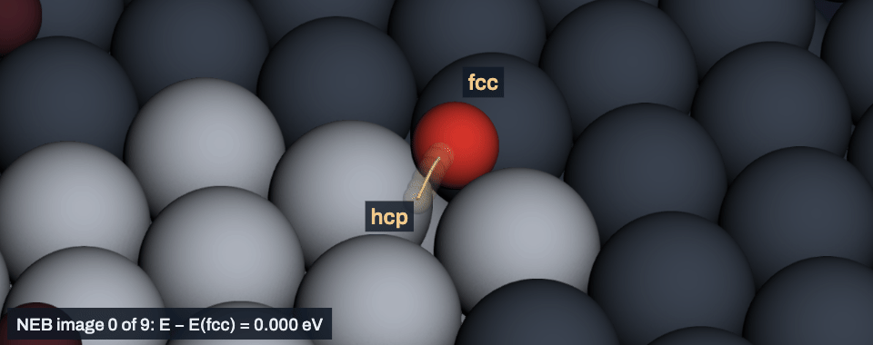
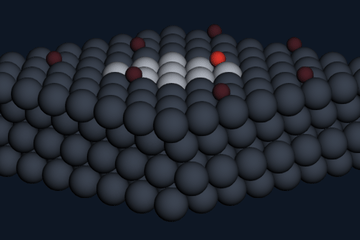
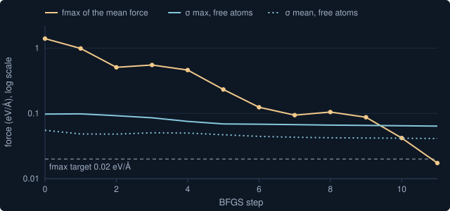
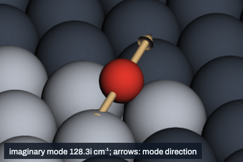
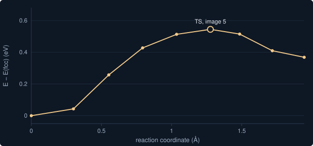
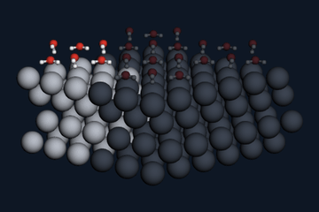
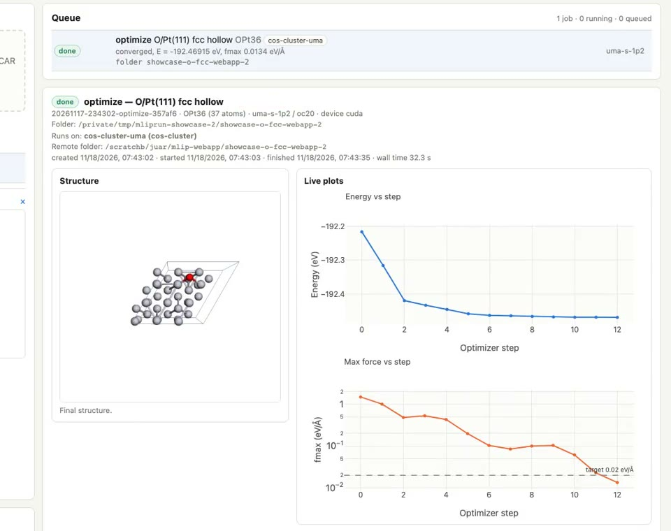

<!-- Generated by site/alt-5-cinematic/build_readme.py from data/*.json. Do not edit by hand. -->
<!-- TODO (promotion, Phase 5): relative links (index.html, data/, media/, ../../) become the GitHub Pages URL and repository-root paths. -->

# mliprun

O hops fcc → hcp on Pt(111); NEB, barrier 0.544 eV. Images, not dynamics.

**One CLI and one web app for machine-learning interatomic potentials** (UMA, MACE, SevenNet, CHGNet). **[Open the interactive page](index.html).**

<table>
<tr>
<td width="320"></td>
<td>

**Relax an adsorbate.** `mlip optimize run --structure POSCAR --mlip uma-s-1p2 --uma-task oc20 --device cuda --fmax 0.02 --optimizer bfgs --max-steps 500` O height 1.13 Å, 12 BFGS steps. **Converged:** fmax 0.0134 eV/Å, target 0.02 eV/Å.

</td>
</tr>
<tr>
<td width="320"></td>
<td>

**Relax with a committee** of 3 models. `mlip optimize run --structure POSCAR --committee committee.yaml --fmax 0.02 --optimizer bfgs --max-steps 500 --uncertainty-plot` Force σ at the end 0.0637 eV/Å (3.68 × fmax). **Converged:** mean-force fmax 0.0173 eV/Å, target 0.02 eV/Å.

</td>
</tr>
<tr>
<td width="320"> </td>
<td>

**Find the path, verify the TS.** Imaginary mode shown (mode, not dynamics). `mlip neb run --initial o_fcc/opt_final.vasp --final o_hcp/opt_final.vasp --mlip uma-s-1p2 --uma-task oc20 --device cuda --num-images 7 --k 0.1 --climb --fmax 0.02 --optimize-endpoints --endpoint-fmax 0.02 --endpoint-optimizer bfgs --verify-ts both --plot` Barrier 0.544 eV, reaction energy 0.368 eV, 128.3i cm⁻¹. **Converged:** band fmax 0.0177 eV/Å, target 0.02 eV/Å; TS verified.

</td>
</tr>
<tr>
<td width="320"></td>
<td>

**Finite-temperature MD.** 6-H₂O bilayer on Pt(111) as built (input to the bilayer relaxation). Static structure, not a simulation. **Pending:** MD not run; next step pending a decision.

</td>
</tr>
<tr>
<td width="320"></td>
<td>

**Run it on your own GPU machine from the web app.** No preconfigured machines: add your own (Machines, Add machine). Showcase job on `cos-cluster`: 28.2 s wall time. Click for the recording. **Converged:** fmax 0.0134 eV/Å, target 0.02 eV/Å.

</td>
</tr>
</table>

Demonstration runs, uma-s-1p2/oc20. [Provenance](../../docs/showcase/data/pack/PROVENANCE.md).

**Also:** `freq run`, `autoneb run`, `benchmark`, `singlepoint run`, `mlip doctor`.

## Installation

One MLIP per environment: see [`docs/INSTALL.md`](../../docs/INSTALL.md), then run `mlip doctor`.
