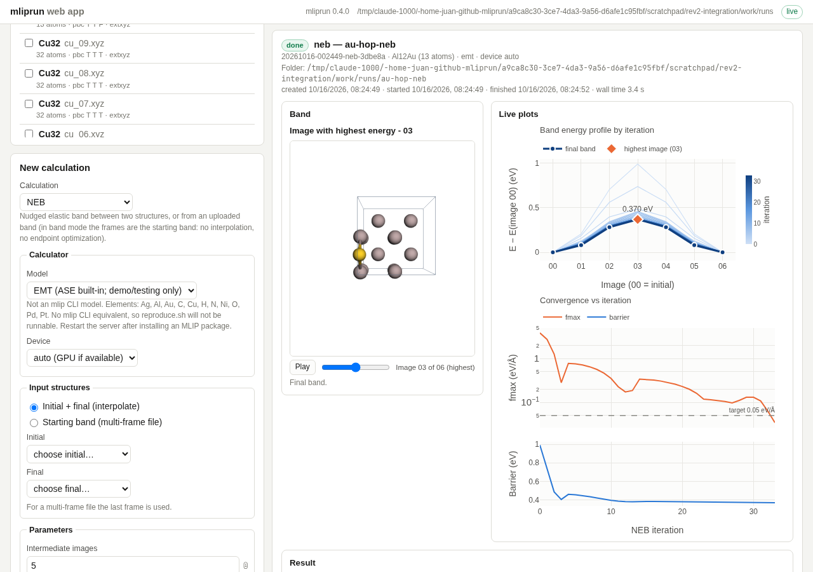

# mliprun web app

A local browser front end for mliprun. You upload structures, fill in a form,
and watch the calculation live: energy and force plots update step by step and
a 3D viewer shows the structure as it moves. Every job runs the same mliprun
core functions the `mlip` CLI uses and writes the same output files, plus a few
web app files (an event log, a summary, a `reproduce.sh` script).

The app is a *server* (a Python program that listens on a network port) plus a
*front end* (the HTML/JavaScript page your browser loads from that server). By
default the server only accepts connections from your own computer.



*A finished EMT NEB (Au adatom hopping between hollow sites on Al(100)): the
viewer on the left shows the image with the highest energy (its title names
the image), the band-evolution plot on the right draws the energy profile of
every iteration (light = early, dark = late) with the final band on top, and
fmax / barrier per iteration below it.*

Contents: [Install](#install) · [Launch](#launch) ·
[Run directories](#run-directories) · [Calculation types](#calculation-types) ·
[Reproducing a job from the CLI](#reproducing-a-job-from-the-cli) ·
[Known limitations](#known-limitations) · [Testing](#testing) ·
[Adding a calculation type](#adding-a-new-calculation-type)

---

## Install

The web app is an optional *extra* (an optional group of dependencies,
declared in `pyproject.toml`): `fastapi` (the web framework), `uvicorn` (the
server that runs it) and `python-multipart` (file uploads).

```bash
cd mliprun
python3 -m venv .venv && source .venv/bin/activate   # always inside a venv
pip install -e ".[webapp]"
pip install mace-torch        # or one other MLIP; see below
mlip doctor                   # verify the environment
```

The install rules of the main package apply unchanged (see
[`AGENTS.md`](../AGENTS.md) and [`docs/install/README.md`](../docs/install/README.md)):

- **One MLIP package per environment.** mace-torch, fairchem-core, sevenn and
  chgnet pin incompatible torch versions. To use two MLIPs from the web app,
  make two venvs and run one server from each (on different `--port`s).
- **Never `pip install asetools`** (the PyPI package of that name is an
  unrelated tool). If you want the NEB interpolation check, use
  `pip install -e ".[neb,webapp]"`.
- UMA (fairchem-core) needs a Hugging Face access request first.

**EMT is always available.** ASE's built-in EMT calculator is listed in the
calculator menu even with no MLIP installed, so you can try every calculation
type immediately. EMT only knows H, C, N, O, Al, Ni, Cu, Pd, Ag, Pt, Au and is
for demos and testing, not for production numbers.

## Launch

```bash
mlip webapp                    # same as: python -m mliprun.webapp
```

This prints the URL (default `http://127.0.0.1:8765/`) and opens it in your
browser after about a second. Stop the server with Ctrl+C; a job still running
at that moment is cancelled.

| Option | Default | Meaning |
|---|---|---|
| `--host` | `127.0.0.1` | Network address to listen on. |
| `--port` | `8765` | TCP port. |
| `--runs-dir` | `~/.mliprun/webapp-runs` | Folder for uploads and job run directories (created if missing). |
| `--no-browser` | off | Do not open a browser window. |

**About `--host`.** `127.0.0.1` ("loopback") means only programs on this
computer can connect. The app has **no login or authentication**. If you bind
to another address (for example `--host 0.0.0.0`, all network interfaces),
anyone who can reach that port can run jobs on your machine and download every
file in the runs directory; the server prints a warning when you do this. To
use the app on a remote workstation or cluster login node, keep the default and
forward the port over SSH instead:

```bash
ssh -L 8765:127.0.0.1:8765 user@workstation    # then open http://127.0.0.1:8765/ locally
```

Even on loopback, the server defends against other web pages in your browser
talking to it: state-changing requests need a custom `X-Mliprun: 1` header,
WebSocket connections from foreign origins are refused, and the `Host` header
is checked (protection against "DNS rebinding").

**Installed a new MLIP?** Restart the server. The list of available MLIPs is
detected once, when the server starts.

**Upgraded mliprun (or pulled new code)?** Restart the server too. A running
server keeps the Python code it started with, so new features and fixes only
appear after Ctrl+C and `mlip webapp` again; then reload the browser page
(Ctrl+Shift+R forces it to fetch the new JavaScript).

## Run directories

Every job has a `job_id` such as `20261016-091502-optimize-a1b2c3` (UTC
creation time, calc type, random suffix). Its files go into a *run folder*
`<Location>/<Folder name>/`, set in the **Job** part of the form:

| Field | Default | Meaning |
|---|---|---|
| **Job name** | the file name (NEB: `initial -> final`) | Shown in the job list and job page. |
| **Location** | the server's `--runs-dir` (the last one you used is remembered by the browser) | Parent directory of the run folder. Absolute or starting with `~`; created if missing; must be writable. |
| **Folder name** | the Job name if you typed one, else the `job_id` | Name of the run folder inside Location. |

Folder names are cleaned to be safe on any file system: every character other
than letters, digits, `.`, `_`, `+` and `-` becomes `-`, repeated dashes are
merged, leading dots/dashes are dropped, and the name is cut to 100
characters. `_uploads` and `_jobs` are reserved, and a Location inside them is
refused.

**Several structures at once.** Ticking N >= 2 structures submits N jobs.
The name field then reads **Common name**, and each job gets the common name
plus a zero-padded index (at least two digits; three from 101 jobs on). The
index follows natural filename order, not the order of the list: names are
compared case-insensitively and numbers by value, so `cu_1`, `cu_2`, `Cu_3`,
`cu_10` get `-00`, `-01`, `-02`, `-03` (files with the same name: oldest
upload first). The same files always get the same indices, also after a page
reload. Example: ten structures with
common name `ch3-is-proposal` give jobs and folders `ch3-is-proposal-00`,
`ch3-is-proposal-01`, ..., `ch3-is-proposal-09`. If you type a Folder name
too, it is the base of the folders instead (`<folder>-00`, ...). With neither,
each job keeps its file name and its `job_id` folder. A preview table under
the fields lists every job's name and full folder path before you submit.
A NEB/AutoNEB is one job, so it never gets a suffix.

**Runs are never overwritten.** If a run folder already exists (even an empty
one, or a file of that name), the job is refused. The form checks this live
while you type: conflicting folders are marked in the preview, the Submit
button is disabled and the reason is shown under it. If the folder appears
between that check and your click, the server refuses the submission and the
message appears next to the Folder field; nothing is created (a
multi-structure submission is all or nothing). After a successful submit the
Job name and Folder name fields are cleared (Location is kept), so the next
submission starts from fresh defaults.

The server keeps a small index file `<runs-dir>/_jobs/<job_id>.json` pointing
at each run folder, so jobs in other locations still show up after a server
restart. Uploaded files are kept in `<runs-dir>/_uploads/<upload_id>/`. The
"Download all" archive is named `<folder>.zip`.

| File | Written by | Content |
|---|---|---|
| `inputs/<role>/<file>` | server | Copy of the uploaded structure (`role` is `structure`, `initial`, `final` or `band`). NEB/AutoNEB also get `inputs/initial.vasp` and `inputs/final.vasp`. |
| `job.json` | server | The full job definition: calc type, calculator, every parameter (defaults filled in), which parameters you changed (`param_sources`), input files. Never modified after submission. |
| `state.json` | server | Current status (pending/running/done/failed/cancelled), process id, timestamps. |
| `events.jsonl` | worker (and server) | One JSON object per line: status changes, phases, log messages, every optimizer/MD/NEB step, the final result. This is what the live plots are drawn from, and it lets the page reload without losing history. |
| `reproduce.sh`, `reproduce.json` | worker | The equivalent `mlip` CLI command (see below). |
| `worker.log` | worker | Everything the calculation printed to stdout/stderr (look here first when a job fails). |
| `summary.json` | worker | Final status, timings, the result numbers, error message if any. |
| everything else | mliprun core | The normal mliprun outputs, exactly as the CLI writes them: `mliprun_run.json`, `opt.traj`, `opt.log`, `opt_convergence.csv`, `CONTCAR`, `md_energy.csv`, `freq_frequencies.csv`, `A2B.traj`, `00/POSCAR`, ... (see [`docs/OUTPUTS.md`](../docs/OUTPUTS.md)). |

Each job runs as a separate Python process (the *worker*,
`python -m mliprun.webapp.worker <run_dir>`), started inside the run directory.
A crash in a calculation therefore never takes the server down; the job is
simply marked failed. The job page lists all files with download links and
has a "Download all (.zip)" button.

## Calculation types

| Type | Input | Live during the run | At the end |
|---|---|---|---|
| `optimize` | one structure | energy vs step, fmax vs step (log scale, with the target line), structure in the 3D viewer | converged flag, final energy and fmax, final structure |
| `md` | one structure | total/potential energy and kinetic energy vs time, temperature vs time (with the target); NPT adds pressure and volume; moving structure | mean temperature, mean total energy and the other run-record results |
| `neb` | initial + final structure, or an uploaded band (≥ 3 frames) | band-evolution plot: the energy profile (E - E of image 00) of every iteration, older ones thin and light, the current one thick; fmax and barrier vs iteration; the viewer jumps to the highest-energy image, titled `Image with highest energy - NN` (00 = initial endpoint), and its slider plays the whole band | forward/reverse barrier, reaction energy, TS image, final band (the title then names the final TS image) |
| `autoneb` | initial + final structure | as `neb`, for the full band (it grows as AutoNEB inserts images; the progress line names the sub-band being relaxed) | as `neb`, from the final `autoneb???.traj` files |
| `singlepoint` | one structure | (nothing to plot) | energy, fmax, stress, forces table and per-atom force plot, atoms coloured by force magnitude |
| `freq` | one structure | progress bar (force calls done / total) | frequency stick plot (imaginary modes highlighted), mode table, ZPE |

How often the structure is sent to the viewer is set by **Structure every N
steps** (default 5; 0 = never). Every step is still plotted. For large systems
or long MD runs a larger value keeps the event log small.

Parameters, defaults and help texts in the form are the same as the CLI's
(`mlip <command> run --help`). Advanced parameters are in a collapsed
"Advanced" section; parameters that do not apply (for example the thermostat in
NVE) are hidden and not sent. Ticking several structures for a single-structure
type submits one job per structure (named as described in
[Run directories](#run-directories)). Non-NEB jobs use the **last** frame of a
multi-frame file, as the CLI does.

Jobs run strictly one at a time, first in, first out. Pending and running jobs
can be cancelled from the job list or the job page.

## Reproducing a job from the CLI

Each run directory contains `reproduce.sh`. Running it copies the input into
`<run_dir>/reproduce/` and runs the equivalent `mlip ... run` command there, with
every parameter written out explicitly, so the web app's own outputs are not
overwritten:

```bash
cd ~/.mliprun/webapp-runs/20261016-091502-optimize-a1b2c3
./reproduce.sh
```

The header of the script states how faithful it is (`reproduce.json` holds
the same status, the notes, and the argument list):

- `exact`: same inputs, same parameters, same calculator.
- `approximate`, with a note saying why: MD NVT/NPT (initial velocities are
  random and unseeded); NEB started from an uploaded band (the CLI cannot start
  from a band); NEB with linear interpolation (the CLI always runs IDPP);
  AutoNEB on a device other than CPU (the CLI `autoneb` has no `--device`); NEB
  inputs that were not VASP files (converted to `inputs/*.vasp`).
- `no`: the job used EMT, which has no `mlip` CLI equivalent. The command is
  written commented out with `--mlip REPLACE_WITH_AN_MLIP`; edit in a real MLIP
  tag to rerun it with a model.

## Known limitations

- **Not available in the UI**: committee mode (`--committee`), `optimize
  batch` (submit several structures instead), `benchmark`, `md --resume`,
  `neb --restart`, and `autoneb-results` (the worker post-processes AutoNEB
  itself). Use the CLI for these.
- **No authentication.** Keep the default `127.0.0.1` binding (use SSH port
  forwarding for remote machines).
- **The 3D viewer and the plots need internet.** 3Dmol.js and Plotly are
  loaded from a CDN (`cdn.jsdelivr.net`, pinned versions). Offline, the page
  shows a banner; uploads, the form, the job list, results tables and file
  downloads still work.
- **MLIP detection happens at server start.** Restart the server after
  installing or removing an MLIP package.
- **One job at a time.** Submitted jobs queue; there is no parallel execution
  or GPU sharing.
- **AutoNEB always runs on CPU in the CLI**, so its `reproduce.sh` is only
  approximate when you choose another device. AutoNEB also deletes earlier
  `autoneb*.traj` files (and `AutoNEB_iter/`) in its run directory; harmless
  here because every job has its own folder, but do not drop extra files with
  those names into a run directory.
- **MD velocities are not seeded**, so NVT/NPT runs are not bitwise
  reproducible (NVE starts from rest and is).
- **EMT jobs have no CLI equivalent** in `reproduce.sh` (status `no`).
- **NEB endpoint optimization and IDPP interpolation** show only a phase
  message, no per-step plot.
- **Upload limits**: 50 files per upload, 50 MB per file; band input 3 to 52
  frames; preview animation for files with up to 500 frames.
- **Tier-2 tests use MACE-MP-0 medium**, because that is what the package
  builds for the `mace` tag; "small" is not selectable.
- **Restarting the server** marks a job that was running as failed ("server
  restarted while the job was running"); pending jobs are re-queued.

- **Code upgrades need a server restart** (see [Launch](#launch)).
- **Moving or deleting a run folder** by hand removes that job from the list
  at the next server start (its index entry is skipped).

Pre-existing issue in the core package (not caused by the web app, not fixed
on this branch):

- `tests/test_md_mace.py::test_mace_md` fails: it passes a stale
  `temperature_K` keyword (the function takes `temperature`).

## Testing

The web app tests live in `tests/webapp/`. Install the test extras first:

```bash
pip install -e ".[dev,neb,webapp]"            # dev brings pytest and httpx
pytest tests/webapp -m "not mace"             # everything except the MACE tier
```

What the groups are, and when they skip:

| Tests | What they check | Needs | Skips when |
|---|---|---|---|
| API, schema, worker, events, hooks, reproduce (`test_api_*.py`, `test_ws.py`, `test_schema.py`, `test_worker.py`, `test_core_hooks.py`, ...) | each component; the API tests use a scripted fake worker | `webapp` extra + `httpx` | fastapi/httpx missing (the import-free ones still run) |
| Tier 1 (`test_tier1_emt.py`, `test_robustness.py`) | every calc type end to end with the real worker and EMT on Cu, Pt, Au, Ni; energies, forces, frequencies and barriers equal a direct mliprun API run; queueing, cancel, crash, restart, security | same | as above |
| Tier 2 (`test_tier2_mace.py`, markers `mace`, `slow`) | short real-MLIP jobs with `mace` (MACE-MP-0 medium) on CPU; energy equals a direct calculator; `reproduce.sh` is `exact` and parses | mace-torch, model download | mace-torch not installed, or the model cannot be built (no network) |
| Browser (`test_browser.py`) | headless Chromium: upload, run optimize, live plot grows, result shown; cancel an MD job from the page | `pip install playwright` and a Chromium (`playwright install chromium`, or a system `/usr/bin/chromium`) and internet (CDN) | playwright missing, no Chromium launches, or the CDN is unreachable |

```bash
pytest tests/webapp/test_tier2_mace.py        # in a MACE env (about 40 s on CPU)
pytest tests/webapp/test_browser.py -v        # check it did not skip
```

The main suite's unit command (`pytest -m "not uma and not mace and not
sevenn"`) includes tier 1 and, if available, the browser test. The repository
rules hold here too: never regenerate `tests/goldens/*`, and use parametrize
ids other than the bare names `uma`, `mace`, `sevenn` (they silently skip).

---

## Adding a new calculation type

The design rule is *one table drives everything*: the form in the browser, the
server-side validation and the `reproduce.sh` flags are all generated from the
calc-type entry in `schema.py`. Adding a type therefore means one schema entry,
one runner function, and plotting/result code on the page. As a running
example, suppose you add `eos` (an equation-of-state scan) that takes one
structure.

Code lives in `src/mliprun/webapp/`; tests in `tests/webapp/`.

### 1. Make sure the core function exists and can report progress

The web app calls `mliprun.core` functions directly, never the CLI. If you want
live plots, the core function needs an optional `observer=None` keyword that it
calls once per step with a plain dict (see how `run_optimization` in
`core/optimize.py` calls it at the end of `log_convergence()`, or `run_md` in
`core/md.py`). Rules: default `None` must leave behaviour and numbers
unchanged; the observer only reads values already computed; exceptions it
raises propagate (that is how cancellation works). Without an observer the type
still works, but only shows the final result (like `singlepoint`).

### 2. Schema entry (`schema.py`)

Add a list of fields built with `_field(...)` and an entry in `CALC_TYPES`:

```python
_EOS = [
    _field("n_points", "Points", "int", 7, min=3, max=50, help="Volumes to evaluate."),
    _field("strain", "Max strain", "float", 0.05, min=0, max=0.3,
           min_exclusive=True, help="Largest linear strain, ±."),
]
CALC_TYPES = [
    ...,
    {"name": "eos", "label": "Equation of state",
     "description": "Energy vs volume around the input cell.",
     "inputs": "single", "cli_command": "eos run", "fields": _EOS},
]
```

- `type` is one of `float`, `int`, `bool`, `choice`, `indices`, `mask3`; the
  form widget and validation follow from it. Use `advanced=True` to put a field
  in the collapsed section and `visible_if=[{"other_field": [values]}]` to show
  it only for some values of an **earlier** field.
- `cli_flag` defaults to `--<name-with-dashes>`; pass `"--x/--no-x"` for CLI
  boolean pairs, or `None` when the CLI has no such option.
- Defaults must equal the CLI defaults.
- `inputs` must be `single`, `pair` or `pair_or_band`. These are the only kinds
  the server (`server.py`, job submission) and the form (`form.js`) know; a new
  kind needs changes in both and in `validate_submission`.
- `validate_submission` (same file) needs no change for ordinary fields: type,
  bounds, choices, visibility and EMT element checks are generic. Add a rule
  there only for cross-field or structure-dependent checks (like the NEB
  "same atoms in initial and final" rule), appending `{"field":
  "params.<name>", "message": ...}` to `errors` so the page can show it next to
  the field.

### 3. Runner (`runners.py`)

Write `run_eos_job(ri: RunInputs) -> dict` and register it in `RUNNERS`.
`ri.structures["structure"]` is the `Atoms` object, `ri.calc` the calculator
(already built by the worker), `ri.params` the validated parameters,
`ri.run_dir` the output directory, `ri.common_kwargs()` the model/device
provenance and `ri.run_context("eos")` the run-record context. Follow
`run_optimize_job` as the template:

```python
def run_eos_job(ri: RunInputs) -> dict:
    from mliprun.core.eos import run_eos          # lazy import, like the others
    atoms = ri.structures["structure"]
    atoms.calc = ri.calc
    res = run_eos(atoms, n_points=ri.params["n_points"], strain=ri.params["strain"],
                  output_dir=ri.run_dir, run_context=ri.run_context("eos"),
                  observer=ri.adapter.eos, **ri.common_kwargs())
    ri.phase("postprocess", "collecting results")
    out = record_common(ri.run_dir, "eos")       # calc_type, record_status, walltime...
    out.update({"v0_A3": res["v0"], "b0_GPa": res["B"],
                "final_frame": encode_frame(atoms.get_positions(), atoms.get_cell())})
    return out
```

The returned dict becomes the `result` event and `summary.json`. Name scalar
keys with a unit suffix (`_eV`, `_eV_per_A`, `_GPa`, `_A3`, `_K`, `_cm1`, ...):
the page shows every scalar automatically and picks the unit from the suffix
(`unitForKey` in `static/js/util.js`). Keys starting with `_` are dropped.
Include `final_frame` (or `band` for a set of images) to update the viewer.

The worker (`worker.py`, `_Worker._run_job`) needs no change for a
single-structure type: it reads inputs, writes `reproduce.sh`, builds the
calculator with `calculators.make_calculator`, emits `phase` events and calls
`RUNNERS[calc_type]`. It only special-cases `neb`/`autoneb`, whose
`CustomNEB` builds its own calculators.

### 4. Live events (`runners.py` ObserverAdapter, `jobs.py`)

Add a method to `ObserverAdapter` that turns your core observer's dict into an
event, e.g. `eos_point` with `{"index", "volume_A3", "energy"}`. Use
`self._with_frame("eos_point")` to decide whether to attach `frame =
encode_frame(positions, cell)` (this implements the "structure every N"
throttle), and emit with `self.writer.emit("eos_point", **event)`. Values are
made JSON-safe automatically (numpy to Python, NaN to `null`).

Then tell the server and page that this is a progress event:

- `jobs.py`: add the type to `PROGRESS_TYPES`, add a branch in the progress
  calculation (the method with the `opt_step` / `md_step` branches) so the job
  list shows "point 3/7", and add an entry to `RESULT_BRIEF_KEYS` (the result
  numbers shown in the job list).
- `static/js/jobs.js`: add the type to its own `PROGRESS_TYPES` set, and a
  branch in `_flushUi()` for the progress bar text.

### 5. `reproduce.sh` (`reproduce.py`)

Add the CLI command to `_CLI_COMMAND` (`"eos": ["eos", "run"]`). Flags come
from the schema's `cli_flag` values automatically. If the CLI command takes its
input differently, or some setting cannot be reproduced, add the special case
and an `approximate` note in `build_reproduce`. If there is no CLI command at
all, give every field `cli_flag=None` and make `build_reproduce` return status
`no` with a note.

### 6. Front end: plots and results (`static/js/`)

- **Form** (`form.js`): nothing to do; it is generated from
  `GET /api/calc-types`.
- **Plots** (`plots.js`): write a class extending `PlotSet` with
  `ingest(ev)` (append the numbers from each progress event, then
  `this.redraw()`) and `draw()` (call `this.react(this.divs.main, traces,
  layout)`, and `this.divs.secondary` for a second plot). For final-only
  results implement `setResult(r)` instead (see `FreqPlots`,
  `SinglepointPlots`). Register it in `CLASSES` at the bottom of the file.
  Use the shared helpers (`line`, `baseLayout`, the `C` colours) so it matches
  the other plots; put quantities with different units in stacked subplots,
  not on twin y-axes.
- **Result panel** (`jobs.js`, `_showResult`): scalars appear automatically.
  Lists (a table of points, like `freq-table` or `forces-table`) need an
  explicit block there; add list-valued keys to the `skip` set so they are not
  shown twice.
- No build step: edit the files and reload the page (hard reload, Ctrl+Shift+R,
  if the browser cached the old script).

### 7. Tests (`tests/webapp/`)

- `test_schema.py`: the generic checks (every type has fields, every
  `visible_if` refers to an earlier field, defaults pass validation) pick up
  the new entry; add a failing case for any custom rule.
- `test_worker.py`: write a `job.json` with EMT on a small Cu cell, run
  `python -m mliprun.webapp.worker <dir>` as a subprocess, assert exit code 0,
  exactly one `result` event, contiguous `seq`, `summary.json` status `done`.
- `test_core_hooks.py`: the observer is called once per CSV row with values
  equal to the CSV, and an observer that raises makes the run fail with
  `mliprun_run.json` status `failed`.
- `test_reproduce.py`: the generated argv parses with the real `mlip` CLI.
- `test_tier1_emt.py`: an end-to-end job whose numbers equal a direct call of
  the core function (every test must assert a number or an invariant).
- `tests/test_characterization_golden.py` must still pass unchanged.

Then start `mlip webapp`, run the new type with EMT, and check the live plots,
viewer, result panel and `reproduce.sh` by eye.
